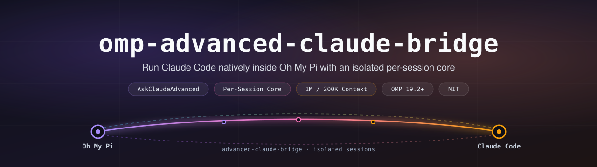
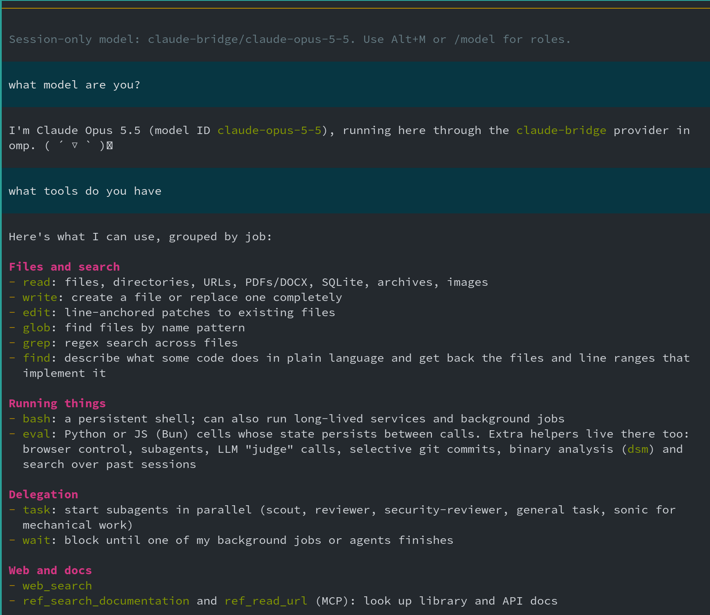

<div align="center">



<h1>omp-advanced-claude-bridge</h1>

<p><strong>Run Claude Code as a first-class model provider inside <a href="https://omp.sh">Oh My Pi</a> — with an isolated per-session core, the AskClaude delegation tool, and switchable 1M / 200K context windows.</strong></p>

<p>
<a href="https://github.com/DevVig/omp-claude-bridge"></a>
<a href="LICENSE"></a>


<a href="https://github.com/its-a-unixsystem/omp-advanced-claude-bridge/actions/workflows/ci.yml"></a>

</p>

</div>

---

> [!NOTE]
> **Fork notice:** `omp-advanced-claude-bridge` is an independently maintained **fork of [DevVig/omp-claude-bridge](https://github.com/DevVig/omp-claude-bridge)** (which itself ported [elidickinson/pi-claude-bridge](https://github.com/elidickinson/pi-claude-bridge) to Oh My Pi).
>
> Compared to `omp-claude-bridge`, this fork adds:
>
> - **Oh My Pi 19.2+ support** — uses OMP's bundled Anthropic catalog (so new Claude models appear automatically), native streaming/tool-schema APIs, and reactive TUI previews.
> - **Rewritten per-session core** — each OMP provider session owns its own Claude Code session, history sync, and deferred steer replay, so in-process subagents and `/btw` side requests never clobber the main agent.
> - **Session-limit / quota protection** — sets `CLAUDE_CODE_ENTRYPOINT=omp-claude-bridge` on all spawned Claude Code subprocesses instead of the Agent SDK default (`sdk-ts`), avoiding Anthropic's inflated 5-hour session-limit burn rate ([anthropics/claude-code#97074](https://github.com/anthropics/claude-code/issues/97074)).
> - **Persistent session resume & verified history sync** — saves native Claude Code resume mappings for file-backed primary OMP sessions, verifies transcript prefixes before copying on rewind/fork, and preserves signed thinking from OMP's native Anthropic provider.
> - **Full OMP system prompt & memory controls** — forwards the full rendered OMP system prompt by default (`systemPromptPreset`), uses Claude Code's default output style, and disables auto-memory unless opted in.
> - **Rate-limit metadata reporting** — surfaces Claude Code rate-limit events through OMP's `after_provider_response` hook as `anthropic-ratelimit-unified-*` headers.
> - **Hardened SDK error and request handling** — surfaces SDK failures instead of empty successes, enforces `allowFullMode: false`, and isolates AskClaude / helper calls from the primary session.
>
> It keeps the original `claude-bridge` provider, `AskClaude` tool, and `claude-bridge.json` config names as a drop-in replacement.

`omp-advanced-claude-bridge` lets you use **Claude Code** — Opus, Sonnet, Haiku, Fable, and Mythos — from inside Oh My Pi, with every tool call flowing through OMP's native TUI. It also exposes an **AskClaude** tool so any other provider can delegate a task or a second opinion to Claude Code, and it gives you **direct control over the context window** each model requests.

Authentication and billing run through Claude Code and your Anthropic subscription via the official [Claude Agent SDK](https://github.com/anthropics/claude-agent-sdk-typescript) — this extension never stores credentials.

<div align="center">
<a href="assets/claude-bridge1.png"></a>&nbsp;
<a href="assets/claude-bridge2.png"></a>
<p><sub><em>Screenshots illustrating native Oh My Pi TUI tool bridging and AskClaude delegation.</em></sub></p>
</div>

## Table of contents

- [Features](#features)
- [Install](#install)
- [Quickstart](#quickstart)
- [Context window controls](#context-window-controls)
- [AskClaude tool](#askclaude-tool)
- [Configuration reference](#configuration-reference)
- [How it works](#how-it-works)
- [Debugging](#debugging)
- [Development](#development)
- [Credits](#credits)
- [License](#license)

## Features

- **Claude Code as a provider** — pick Opus / Sonnet / Haiku / Fable / Mythos from `/model` under `claude-bridge/*`; tool calls render in OMP's TUI like any native provider.
- **Isolated per-session core** — each OMP provider session owns its own Claude Code transcript, history sync, and deferred steer replay, so in-process subagents and `/btw` side requests never collide with the main agent.
- **Oh My Pi 19.2+ native integration** — built against OMP's bundled Anthropic catalog, native streaming/tool-schema APIs, and reactive TUI previews.
- **AskClaude delegation tool** — from any other provider, hand a task or question to Claude Code (read-only, no-tools, or full read/write/bash), optionally in an isolated session.
- **Switchable context window** — pick **1M** or **200K** directly in `/model`, or set a global default (`auto`, `1m`, `200k`) built on upstream `omp-claude-bridge`'s measured per-model policies.
- **Session resume & history sync** — file-backed primary OMP sessions can resume their native Claude Code transcript after a restart and keep unchanged history on rewinds. History imports preserve signed thinking from OMP's native Anthropic provider.
- **Full OMP system prompt** — Claude Code gets OMP's skills, `AGENTS.md`, and instructions from OMP extensions or the command line.
- **Thinking support** — effort levels map through to Claude Code, including `xhigh` on Sonnet models.
- **MCP tool bridging** — strict-config isolation by default.

## Install

Requires Oh My Pi 19.2.1 or newer in the 19.x series and a working Claude Code login.

```bash
omp plugin install git:github.com/its-a-unixsystem/omp-advanced-claude-bridge
```

<details>
<summary>Other install methods</summary>

```bash
# From the full HTTPS URL
omp plugin install https://github.com/its-a-unixsystem/omp-advanced-claude-bridge

# Link a local checkout (great for hacking on it)
git clone https://github.com/its-a-unixsystem/omp-advanced-claude-bridge.git
(cd omp-advanced-claude-bridge && bun install)
omp plugin link ./omp-advanced-claude-bridge
```

</details>

## Quickstart

1. Install the plugin (above).
2. In OMP, run `/model` and choose a `claude-bridge/*` model, for example `claude-bridge/claude-sonnet-5`.
3. Work as usual. Tool calls run through OMP's TUI; Claude Code handles the model turn.

To delegate from another provider instead, just ask: *"Ask Claude to review this plan and poke holes in it."*

## Context window controls

Claude Code serves different context windows depending on the exact model id it receives (e.g. bare `claude-fable-5` serves 200K, while `claude-fable-5[1m]` serves 1M). This extension exposes both as **separate entries in the `/model` picker**, so you choose the window on demand:

- `claude-bridge/claude-opus-4-8` → **Opus 4.8 (1M)**
- `claude-bridge/claude-opus-4-8-200k` → **Opus 4.8 (200K)**

Switching window is just picking the other entry — no config edit, no reload. Every model appears once per window it supports, the `(1M)` / `(200K)` label is always shown, and each entry reports its true window so OMP's status bar and auto-compaction threshold stay accurate.

### Default window

The **unsuffixed** id (e.g. `claude-opus-4-8`) maps to a default window; the other window gets a `-1m` / `-200k` suffixed id. `provider.contextWindow` in `~/.omp/agent/claude-bridge.json` picks that default — it no longer hides models, it only decides which window is unsuffixed:

```json
{
  "provider": {
    "contextWindow": "auto"
  }
}
```

| Mode | Default (unsuffixed) window |
| ---- | -------- |
| `"auto"` *(default)* | Per-model measured default. Respects `plan` and `longContextExtraUsage`. |
| `"1m"` | 1M where the model has a 1M runtime, else its only window. |
| `"200k"` | 200K where the model has a 200K runtime, else its only window. |

Both windows stay in the picker regardless of this setting (wherever a runtime exists); it only changes which one is the plain, unsuffixed id. So `modelRoles` / `enabledModels` that reference `claude-bridge/claude-opus-4-8` keep working and follow the default.

### Windows offered per model

Models are loaded dynamically from Oh My Pi's bundled Anthropic catalog (newest generation first per family, excluding dated snapshot aliases). With OMP 19.2.1's bundled catalog, the registered models and context windows are:

| Model | 200K entry | 1M entry | `auto` default |
| ----- | :--------: | :------: | :------------: |
| `claude-fable-5-2` | ✓ | ✓ | 200K |
| `claude-fable-5-1` | ✓ | ✓ | 200K |
| `claude-fable-5` | ✓ | ✓ | 200K |
| `claude-mythos-5-2` | ✓ | ✓ | 200K |
| `claude-mythos-5-1` | ✓ | ✓ | 200K |
| `claude-mythos-5` | ✓ | ✓ | 200K |
| `claude-opus-5-5` | ✓ | ✓ | 1M |
| `claude-opus-5` | ✓ | ✓ | 1M |
| `claude-opus-4-8` | ✓ | ✓ | 1M |
| `claude-opus-4-7` | — | ✓ | 1M |
| `claude-opus-4-6` | ✓ | ✓ | 200K¹ |
| `claude-opus-4-5` | ✓ | — | 200K |
| `claude-sonnet-5-5` | ✓ | ✓ | 1M |
| `claude-sonnet-5` | ✓ | ✓ | 1M |
| `claude-sonnet-4-6` | ✓ | ✓ | 200K² |
| `claude-sonnet-4-5` | ✓ | — | 200K |
| `claude-haiku-5-5` | ✓ | ✓ | 1M |
| `claude-haiku-4-5` | ✓ | — | 200K |

- ¹ Opus 4.6's `auto` default is 1M when `plan: "max"` or `longContextExtraUsage: true`.
- ² Sonnet 4.6's `auto` default is 1M when `longContextExtraUsage: true`.

The suffixed alternate exists only for the window that isn't the default — e.g. under `auto` you get `claude-opus-4-8` (1M) + `claude-opus-4-8-200k`, and under `"200k"` you get `claude-opus-4-8` (200K) + `claude-opus-4-8-1m`.

> Forcing 1M is a *request*: some models may still be **served** 200K by your subscription entitlement. Set `CLAUDE_BRIDGE_DEBUG=1` to log the served window (see [Debugging](#debugging)).

> An invalid `contextWindow` value logs a warning and falls back to `"auto"`, so a typo never breaks startup.

## AskClaude tool

Available whenever the active provider is not `claude-bridge`. Your current model can hand work to Claude Code and wait for the result:

- "Ask Claude to plan a fix."
- "If you get stuck, ask Claude for help."
- "Ask Claude to review the plan in @foo.md, implement it, then ask an `isolated=true` Claude to review the implementation."
- "Ask Claude to poke holes in this theory."
- "Find all the places in the codebase that handle auth."

You can also name the tool in a skill or AGENTS.md: *"Call AskClaude to review the implementation before marking the task complete."*

### Parameters

| Parameter | Values | Description |
| --------- | ------ | ----------- |
| `prompt` | string | The question or task for Claude Code. |
| `mode` | `read` (default), `none`, `full` | `read` = read files + web; `full` = read/write/bash. Lock `full` out with `allowFullMode: false`. |
| `model` | `opus` (default), `sonnet`, `haiku`, or a full id | Which Claude model handles the delegation. |
| `thinking` | `off`, `minimal`, `low`, `medium`, `high`, `xhigh` | Effort level. |
| `isolated` | boolean (default `false`) | When `true`, Claude gets a clean session with no conversation history. |

## Configuration reference

The extension reads `~/.omp/agent/claude-bridge.json` and the project's `.omp/claude-bridge.json`. Project settings override global settings. Start with [`claude-bridge.example.json`](claude-bridge.example.json).

```json
{
  "askClaude": {
    "enabled": true,
    "allowFullMode": true,
    "defaultIsolated": false
  },
  "provider": {
    "contextWindow": "auto",
    "plan": "pro",
    "longContextExtraUsage": false,
    "autoMemoryEnabled": false,
    "systemPromptPreset": "claude_code",
    "strictMcpConfig": true
  }
}
```

**`askClaude`**

| Key | Default | Description |
| --- | ------- | ----------- |
| `enabled` | `true` | Register the delegation tool. |
| `name` | `"AskClaude"` | Override the tool's OMP-side name. |
| `label` | `"Ask Claude Code"` | Override the TUI label. |
| `description` | — | Override the tool description shown to the model. |
| `defaultMode` | `"read"` | `"read"`, `"none"`, or `"full"`. |
| `defaultIsolated` | `false` | Start each call in a fresh session. |
| `allowFullMode` | `true` | Set `false` to reject explicit `mode: "full"` calls. A configured `"full"` default falls back to `"read"`; `"none"` and `"read"` defaults are unchanged. |
| `appendSkills` | `true` | Forward OMP's skills block into the system prompt. |

**`provider`**

| Key | Default | Description |
| --- | ------- | ----------- |
| `contextWindow` | `"auto"` | `"auto"`, `"1m"`, or `"200k"`. See [Context window controls](#context-window-controls). |
| `plan` | `"pro"` | Set to `"max"` to enable Opus 4.6 at 1M in `auto`. |
| `longContextExtraUsage` | `false` | Opt into metered 1M usage (enables Sonnet 4.6 1M everywhere, Opus 4.6 1M on Pro). |
| `autoMemoryEnabled` | `false` | Let Claude Code use its own auto-memory on provider turns, excluding side requests and helpers. |
| `systemPromptPreset` | `"claude_code"` | Append OMP's full rendered system prompt to Claude Code's preset. Set `false` or `null` to use the OMP prompt alone. The bridge warns and ignores invalid values. |
| `appendSystemPrompt` | — | Deprecated. Set `false` to use Claude Code's preset without forwarding OMP's prompt, if you have not set `systemPromptPreset`. |
| `settingSources` | `["user", "project"]` in legacy opt-out mode | Claude Code filesystem settings to load in legacy opt-out mode. |
| `strictMcpConfig` | `true` | Block MCP servers from `~/.claude.json` / `.mcp.json`. Cloud MCP is always blocked. |
| `pathToClaudeCodeExecutable` | — | Path to the `claude` binary, if the bundled one can't run on your OS/filesystem. |

An explicit `systemPromptPreset` takes precedence over `appendSystemPrompt`. Remove the deprecated key to use the default and forward the full rendered OMP prompt, including `--append-system-prompt` and extension changes. With prompt forwarding on, the bridge does not load `settingSources` or add Claude Code's Git instructions.

The bridge uses Claude Code's `"default"` output style for provider and helper queries. AskClaude and isolated helper requests keep auto-memory off even when provider turns opt in.

A longer system prompt uses more input tokens. The bridge has not measured any billing effect from changing the preset. See [Anthropic's Agent SDK plan guidance](https://support.claude.com/en/articles/15036540-use-the-claude-agent-sdk-with-your-claude-plan) for billing details.

## How it works

OMP's built-in tools are bridged to Claude Code and back via an in-process MCP server (`custom-tools`), so from your side it behaves like any other OMP provider. On registration, the extension reads OMP's bundled Anthropic catalog and applies the bridge's context-window policy in [`src/models.ts`](src/models.ts).

Each OMP provider session keeps its own state in `providerSessionState` (managed by [`src/bridge-session.ts`](src/bridge-session.ts), [`src/query-state.ts`](src/query-state.ts), and [`src/history-sync.ts`](src/history-sync.ts)). Concurrent subagents and `/btw` requests do not share the main session's native transcript.

### Session history

The bridge resumes the native Claude Code transcript while OMP's history and rendered system prompt still match. When you rewind, edit, or fork a session, the bridge verifies the native transcript prefix before copying it up to a point with no unanswered tool calls. This preserves records such as `@file` attachments and imports the changed suffix, including images. A system prompt change or a failed prefix check rebuilds from OMP history.

The bridge saves resume mappings for file-backed primary OMP sessions under `~/.omp/agent/claude-bridge/sessions/` (or under the active OMP agent directory) with file mode `0600`. Claude Code stores the transcripts in its own project directory. If the mapping is missing or corrupt, or its transcript is missing, the bridge rebuilds from OMP history. Subagents, `/btw` requests, and AskClaude do not write the primary session's mapping or transcript.

### Rate-limit metadata

The bridge exposes Claude Code's rate-limit events as `anthropic-ratelimit-unified-*` headers through the provider response callback (`onResponse(response, model, signal)`), which OMP publishes as `after_provider_response`. Utilization stays fractional (`0.8` means 80%), and reset values are Unix seconds. The latest event received between tool turns goes to the continuation of the query that received it, not an unrelated request. OMP's built-in `/usage` does not use these headers for this custom provider.

## Debugging

Set `CLAUDE_BRIDGE_DEBUG=1` for detailed logs:

- **Bridge log** — `~/.omp/agent/claude-bridge.log`: every provider call, session-sync decision, tool-result delivery, and Claude Code stderr. Override the path with `CLAUDE_BRIDGE_DEBUG_PATH`.
- **Per-query CLI logs** — `~/.omp/agent/cc-cli-logs/<timestamp>-<tag>-<seq>.log`: the Claude Code subprocess's own debug stream, one file per query. Tags are `provider`, `continuation`, or `askclaude`.

When filing a session-resume bug (e.g. "No conversation found"), the `syncResult:` lines from the bridge log plus the matching `cc-cli-logs/` file are the most useful attachments.

## Development

```bash
git clone https://github.com/its-a-unixsystem/omp-advanced-claude-bridge.git
cd omp-advanced-claude-bridge
bun install

bun run typecheck   # tsc --noEmit
bun run test        # node unit suite, then the bun bridge suite
```

See [CONTRIBUTING.md](CONTRIBUTING.md) for the full workflow. CI runs typecheck and tests on every push and PR.

## Credits

This project is a **fork** with the following lineage:

- **Original project:** **[pi-claude-bridge](https://github.com/elidickinson/pi-claude-bridge)** by **[Eli Dickinson](https://github.com/elidickinson)** — the streaming provider, MCP/tool bridging, session resume, and AskClaude tool this project builds on (with initial inspiration from [claude-agent-sdk-pi](https://github.com/prateekmedia/claude-agent-sdk-pi) by Prateek Sunal).
- **Upstream Oh My Pi port:** **[omp-claude-bridge](https://github.com/DevVig/omp-claude-bridge)** by **[Jonathan Borgwing](https://github.com/DevVig)** — the Oh My Pi port and switchable context-window controls that this repository was forked from.

See [NOTICE](NOTICE) for full attribution.

> Anthropic [announced and then unannounced](https://support.claude.com/en/articles/15036540-use-the-claude-agent-sdk-with-your-claude-plan) a change to how Agent-SDK tool usage is billed. As of June 15, 2026 it uses your subscription quota just like Claude Code direct.
>
> To avoid Anthropic's higher 5-hour session-limit metering on the Agent SDK's default `sdk-ts` entrypoint ([anthropics/claude-code#97074](https://github.com/anthropics/claude-code/issues/97074)), the bridge sets `CLAUDE_CODE_ENTRYPOINT=omp-claude-bridge` on every spawned Claude Code subprocess (overriding any inherited host value).

## License

[MIT](LICENSE) © 2026 Eli Dickinson (original), Jonathan Borgwing (Oh My Pi port and context-window controls) and Thomas Übermeier (omp-advanced-claude-bridge).
